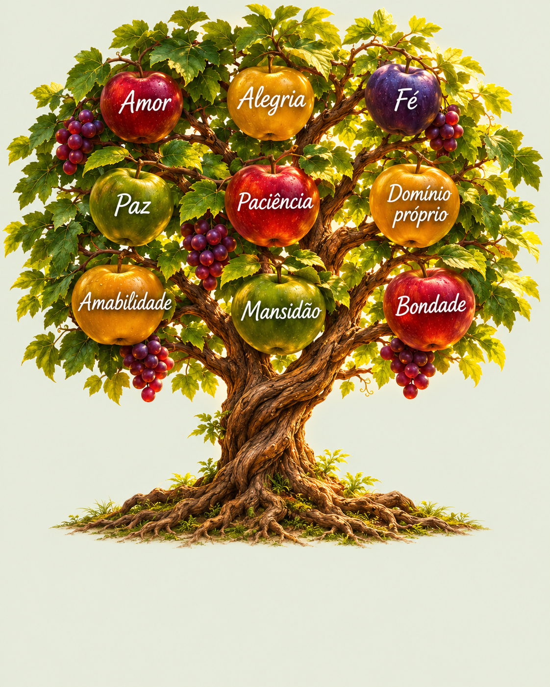
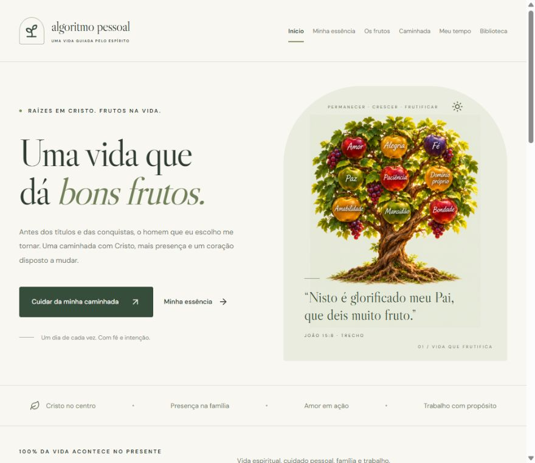

<div align="center">



# Algoritmo Pessoal

### Uma vida guiada pelo Espírito

**Raízes em Cristo. Frutos na vida.**

Um projeto de Alex Nunes Feitoza para cuidar do coração,
organizar o tempo e transformar escolhas em atitudes.

[Propósito](#-o-propósito) · [Prioridades](#-a-ordem-que-escolhi) · [O site](#-um-espaço-para-a-caminhada) · [Começar](#-como-abrir-o-site)

</div>

---

## 🌱 O propósito

Quero me tornar um homem em quem os frutos do Espírito venham primeiro. Quero que essa escolha apareça na maneira como escuto, como respondo às dificuldades, como cuido da minha família e como trato as pessoas.

Minha profissão faz parte da minha história e contribui para o meu sustento. Minha vida com Cristo é o que desejo colocar no centro das minhas decisões.

Este projeto nasceu para dar continuidade a essa caminhada: guardar o que aprendo, reconhecer o que precisa mudar e escolher uma atitude possível para o próximo dia.

> **“Nisto é glorificado meu Pai, que deis muito fruto; e assim sereis meus discípulos.”**  
> João 15:8

## 🕊️ A ordem que escolhi

| Prioridade | Área da vida | O que desejo cultivar |
| :---: | --- | --- |
| **01** | **Vida espiritual** | Permanecer em Cristo, conhecer as Escrituras, orar e viver a fé nas atitudes. |
| **02** | **Cuidado pessoal** | Cuidar do sono, da saúde, da alimentação, do descanso e do aprendizado. |
| **03** | **Família** | Oferecer presença, escuta, amor e cuidado aos meus vínculos. |
| **04** | **Trabalho** | Cumprir minhas responsabilidades e buscar o sustento com honestidade e propósito. |

A prioridade espiritual orienta todas as outras áreas. Ela acompanha a maneira como descanso, convivo e trabalho.

## 🍎 Os frutos que desejo cultivar

<div align="center">

**Amor · Alegria · Paz**  
**Paciência · Amabilidade · Bondade**  
**Fidelidade · Mansidão · Domínio próprio**

<sub>O fruto do Espírito — Gálatas 5:22–23</sub>

</div>

O projeto também preserva **Os Frutos de uma Vida em Cristo**, uma organização devocional com **69 expressões de fé vivida**, fornecida como referência para o acompanhamento:

| Dimensão | Expressões | Na vida cotidiana |
| --- | :---: | --- |
| Frutos de convivência | 20 | Respeitar, escutar, agradecer, perdoar e fazer o bem. |
| Amor e misericórdia | 10 | Ensinar, acolher e cuidar de quem precisa. |
| Serviço e assistência | 15 | Servir, interceder, discipular e defender os vulneráveis. |
| Transformação espiritual | 9 | Cultivar o caráter descrito em Gálatas 5:22–23. |
| O amor em ação | 15 | Refletir sobre o amor à luz de 1 Coríntios 13. |

Essa lista reúne princípios e práticas cristãs. Os 69 itens não são uma enumeração literal de um único texto bíblico nem uma pontuação de espiritualidade.

> O fruto não existe para enfeitar a árvore. Ele alimenta, edifica e cumpre o propósito de Deus.
>
> *Reflexão que orienta este projeto, associada a João 15:8.*

## ⏳ Vinte e quatro horas para viver

Tenho **24 horas por dia**. Quero aprender a distribuí-las de acordo com aquilo que escolhi priorizar.

A área **Meu tempo** permite planejar essas horas, acompanhar os percentuais de cada área e visualizar o tempo que ainda falta destinar. A soma respeita o limite de 24 horas.

Os horários começam em zero para que a divisão seja construída a partir da minha realidade. Sono, refeições e descanso fazem parte desse cuidado. O planejamento expressa uma intenção; ele não mede automaticamente o tempo vivido.

## 📖 Um espaço para a caminhada

O site reúne seis espaços:

| Espaço | Para que existe |
| --- | --- |
| **Início** | Relembrar meu propósito e encontrar uma direção para o dia. |
| **Minha essência** | Guardar quem desejo ser e os valores que orientam minhas escolhas. |
| **Os frutos** | Explorar os 69 frutos, ler passagens comentadas, consultar a concordância bíblica e encontrar sugestões de prática. |
| **Caminhada** | Escrever reflexões, revisitar experiências e guardar aprendizados. |
| **Meu tempo** | Distribuir as 24 horas entre vida espiritual, cuidado pessoal, família e trabalho. |
| **Biblioteca** | Consultar os registros que dão continuidade ao projeto. |

<details>
<summary><strong>Ver a aparência do site</strong></summary>

<br />



</details>

## 🚀 Como abrir o site

**Requisitos:** Node.js 22.13 ou superior, npm e os arquivos locais de memória em `_ia/`. Essa pasta é privada e não acompanha um clone do repositório; em outra máquina, restaure sua própria cópia antes de iniciar o site.

Na primeira utilização, abra um terminal na raiz deste projeto:

```powershell
cd site
npm ci
npm run dev
```

Depois de instalar as dependências, também é possível abrir pelo arquivo **[INICIAR-SITE.cmd](INICIAR-SITE.cmd)**, na raiz do projeto.

Acesse **[http://127.0.0.1:5173](http://127.0.0.1:5173)** enquanto o servidor estiver em execução. Para encerrá-lo, pressione `Ctrl+C` no terminal.

As instruções técnicas completas estão no **[README do site](site/README.md)**.

## 🔄 Como manter a caminhada atualizada

As conversas relevantes são consolidadas nos arquivos locais de memória. Esses registros alimentam a biblioteca do site.

- **Iniciar:** retomar o ponto em que a caminhada parou.
- **Durante a conversa:** registrar mudanças de direção, escolhas e próximos passos.
- **Finalizar:** consolidar o que foi trabalhado para a próxima retomada.

Com o servidor aberto, alterações nos arquivos Markdown de `_ia/` atualizam o conteúdo da biblioteca. Para sincronizar manualmente, execute na pasta `site`:

```powershell
npm run sync
```

Mudanças de identidade ou propósito também exigem revisão dos textos da interface. O site não captura conversas automaticamente nem atualiza a memória global de outros chats.

## 🔐 Onde ficam os registros

| Conteúdo | Onde é guardado |
| --- | --- |
| Perfil, direção e memória do projeto | Arquivos locais em `_ia/`, ignorados pelo Git. |
| Reflexões do caderno e fruto escolhido | Armazenamento local deste navegador. |
| Divisão planejada das 24 horas | Armazenamento local deste navegador. |
| Backup exportado do caderno | Arquivo JSON salvo por quem usa o site. |

O caderno oferece **exportação e importação de backup**. Seus registros não são enviados automaticamente para `_ia/` ou para outros dispositivos. A distribuição de horas é salva separadamente e não faz parte do backup do caderno.

Limpar os dados do navegador pode apagar os registros locais. A versão atual é pessoal e local, sem conta ou sincronização remota. A memória ignorada pelo Git precisa de um backup próprio; o repositório não substitui esse cuidado.

## 🛠️ A tecnologia a serviço do propósito

**React · TypeScript · Vite · CSS · Lucide**

Na pasta `site`, os comandos de manutenção são:

```powershell
npm run check   # Verificar os tipos do código ativo
npm run build   # Gerar a versão em dist/local/
npm run preview # Abrir a versão compilada localmente
```

A tecnologia ajuda a organizar e acompanhar. A transformação é cultivada nas escolhas de cada dia.

---

<div align="center">

**Uma vida em construção.**  
Com graça, verdade e um passo de cada vez.

🌱

</div>
